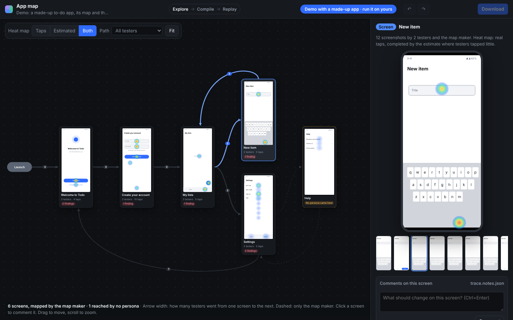

# The map of your app's screens (experimental)

Each Android tester leaves its path in `trace.json` ([docs/replay.md](replay.md)). The dashboard draws every screen of the app as a map, puts the paths of the testers on it, and lets you comment each screen or turn what is wrong on it into a check that the replay verifies.

<a href="https://pierridotite.github.io/mobile-agent-testers/"></a>

[Try the demo online](https://pierridotite.github.io/mobile-agent-testers/), with a made-up app, or [watch the video](../assets/dashboard-demo.mp4).

```bash
bash scripts/collect.sh <run id>                 # decrypts the results into runs/<run id>/
python3 scripts/dashboard.py runs/<run id>       # opens http://127.0.0.1:8765
python3 scripts/dashboard.py --demo              # a made-up run, to try it
python3 scripts/dashboard.py runs/<map run> runs/<run id>   # several runs on one map
```

Python 3.9 or later, nothing to install. The page runs in your browser and the results never leave your machine: the server listens on `127.0.0.1` only and never serves `trace.params.json`, the texts the agent typed.

## First, find every screen

ECR starts by exploring. Here, that is the job of the map maker: an agent with [briefs/map.md](../briefs/map.md) instead of a persona's brief. It opens every control of every screen once, breadth first, and comes back. Its path is a trace like any other, so each screen it found has a path that replays with no model. Run the workflow with `brief: briefs/map.md`; one persona is enough.

Open its run together with the persona runs. The map then shows every screen of the app, and the screens no persona reached are marked "No persona came here": a part of the app the testers never saw, or never found.

## The map

- **One card per screen**, with the screenshot, how many testers came, how many taps, and the findings seen there. Screenshots of the same screen are grouped, even across languages (by the ids of their elements).
- **Arrows** from one screen to the next. The wider the arrow, the more testers went that way. A dashed arrow is a way only the map maker took.
- **A heat map on each screen**: the real taps of the testers, an estimate of where people would look and tap, or both (the estimate fills in where testers tapped little). The estimate weighs each control by its size and by how often testers tapped it on other screens. A file `NN.saliency.json` next to a screenshot (`{"points": [[x, y, weight], ...]}`, x and y from 0 to 1), from a saliency model of your choice, replaces it.
- Click a screen to open it on the right: its screenshots, its comments, the findings, the testers who came, where they came from and where they went next.
- **Checks on a screen**: "Add a check", click an element on the screen, then say whether it must be visible or must not be. From a finding, "Make it a test" does the same, marked as a known bug. See below.
- **One tester's path**: pick it in "Path", or "Show path" on a screen. Its arrows stand out, the other screens fade, and the panel lists its screens in order.

Drag to move the map, scroll to zoom. Comments on a screen go to `trace.notes.json` of the first persona who saw it, under `screens`. Undo and redo with Ctrl+Z and Ctrl+Shift+Z, save with Ctrl+S.

## From a finding to a test

A trace recorded from an agent is a path with no check: replayed, it only proves that the taps still work. The checks come from here. A check added on a screen becomes an oracle of the step that led to that screen, in `checkpoints` of `trace.json`: `visible` or `notVisible`, of an element found by its name or its id, never by a position or by its rank among elements with the same name: "visible" holds when any element with that name is on the screen, "not visible" when none is. "Known bug" records it as `observed: "failed"`: the compiled flow is red until the bug is fixed, then "Fixed" keeps the check as a guard ([Explore-Compile-Replay](https://github.com/pierridotite/explore-compile-replay), "a defect is a test").

Only checks can change. The steps stay as the agent explored them, the server refuses a trace whose steps differ, and the first save keeps the explored trace as `trace.explored.json`. Step ids never change. No check is verified when you write it: the first replay on the unchanged app does ([docs/replay.md](replay.md)).

To check each save with the real command (Node 22.18 or later):

```bash
git clone https://github.com/pierridotite/explore-compile-replay ../explore-compile-replay
(cd ../explore-compile-replay && pnpm install)
python3 scripts/dashboard.py runs/<run id> --ecr ../explore-compile-replay
```

A save is then refused if `ecr validate` finds the trace invalid. Then `ecr compile` turns it into a Maestro flow that replays on every build with no model.

`trace.notes.json` also counts, per trace, the checks added and the seconds spent adding them (`effort`), the human time that a test costs.

## The online demo

`python3 scripts/dashboard.py --demo --export site/` writes the page and the made-up run as static files that any web host can serve. With no server, edits stay in the page and Save downloads the edited files. Only the demo can be exported: a real run is private.

## Limits

- Android only, like the traces.
- The estimated heat map is a guess from the screen's controls, not a model trained on eye tracking. Use real taps, or a saliency file, when it matters.
- Screenshots are grouped by the ids of their elements. An app without ids (many Flutter apps) is grouped by the names of its buttons, so the same screen in two languages counts as two.
- The page has been tried on the demo run and on traces written by the offline tests. Not yet on a run on a real emulator.
