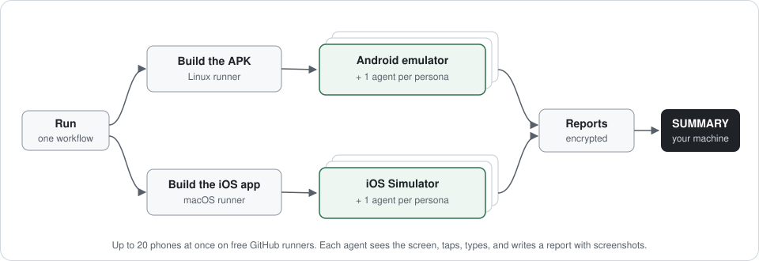

# SSS

[English](faq.md) · [简体中文](faq.zh-CN.md) · [日本語](faq.ja.md) · [Español](faq.es.md) · [Português](faq.pt-BR.md) · [Tiếng Việt](faq.vi.md) · Türkçe

## 20 ajan aynı hatayı 20 kez mi buluyor?

Hayır. LocalSend'de 103 rapor 46 farklı hataya karşılık geliyordu ve bunların 29'unu, engelleyici hata dahil, yalnızca tek bir ajan buldu ([grafik](examples.tr.md#localsend-20-ajan-20-cihaz-14-dil)). Sağdan sola hataları yalnızca iki Arapça personadan, tablet hataları da dört tabletten geldi. Tekrarlananlar, boş cihaz listesi gibi herkesin karşılaştığı, uygulamanın genelindeki durumlardı.

## Maliyeti ne kadar?

GitHub'ın runner'ları public repolar için ücretsizdir, macOS dahil. [Bu çalıştırmalarda](runs/) model kullanımı ajan başına 0,15 ile 0,55 $ arasındaydı, yani 20 telefon için yaklaşık 5 $. Claude aboneliğinle çalıştırmalar fatura yerine planının kullanımından düşer. Daha az harcamak için `model=haiku` ya da başka bir sağlayıcının modelini kullan: [docs/cheaper-models.md](cheaper-models.md).

## Bir çalıştırma ne kadar sürer?

Her ajan 1 ile 18 dakika arasında keşif yapar. AnkiDroid'in 10 Android ajanı, başlangıçtan son rapora kadar 10 dakikadan kısa sürdü. LocalSend'in 20 cihazı build'ler dahil 69 dakika sürdü, çünkü Free plan aynı anda 5 macOS işi çalıştırıyor.

## Mac'e ihtiyacım var mı?

Hayır. Her şey GitHub'ın runner'larında çalışır: Android için Linux, iOS için macOS. `gh` CLI'ına ve bir Claude aboneliğine ya da API anahtarına ihtiyacın var; gerisini `./setup.sh` (Windows'ta `.\setup.ps1`) halleder.

## İki çalıştırma aynı sonucu verir mi?

Hayır. Her ajan keşif yapar, bu yüzden iki çalıştırma asla aynı yolu izlemez: aynı listeyi değil, aynı türden hataları bekle. Regresyonlar için scriptli testleri (Maestro, Appium) koru, bkz. [nasıl karşılaştırıldığı](compare.md).

## Raporlarım herkese açık mı?

Hayır. Public bir reponun logları herkese açıktır, bu yüzden raporlar, ekran görüntüleri ve videolar runner'dan çıkmadan önce senin anahtarınla şifrelenir ve yalnızca sen çözebilirsin. Analitik host'ları telefonların içinde engellenir. Gerçek hesaplar değil, her zaman test hesapları kullan. Ayrıntılar [PRIVACY.md](../PRIVACY.md) dosyasında.

## Kapalı kaynak bir uygulamayı test edebilir miyim?

Evet. Workflow'u, uygulamanın reposu için salt okunur bir `SOURCE_REPO_TOKEN` ile private bir repodan çalıştır ya da `android_build` ve `ios_build` girdilerini hazır derlenmiş bir APK veya .app dosyasına yönlendir. Private repolar Actions dakikalarını kullanır ve macOS dakikaları on kat sayılır.

## Kendi personalarımı oluşturabilir miyim?

Evet. Bir persona, [personas.json](../personas.json) içinde birkaç satırdır: cihaz, işletim sistemi sürümü, dil, yazı boyutu, karanlık mod, konum, kim olduğu ve ne yapmaya çalıştığı. `device` içinde iki isteğe bağlı ayar var: `"increase_contrast": true` (iOS'ta Kontrastı Artır, Android'de yüksek kontrastlı metin) ve `"reduce_motion": true` (yalnızca iOS: Android emülatörleri zaten animasyonsuz çalışır).

## Neyi yanlış yapıyor?

Bazen bir ekranı yanlış okur: LocalSend'in 20 ajanından 3'ü Simulator'ın İngilizce klavyesini uygulamanın bir parçası sandı. Ajan başına birkaç dakika, büyük bir uygulamanın her köşesini değil, ana akışları kapsar. Her bulgu numaralı ekran görüntüleriyle gelir; bir şeyi kaydetmeden önce onları kontrol et.

## Sınırlar

- GitHub runner'ları public repolar için ücretsizdir: aynı anda yaklaşık 20 iş, macOS'ta 5.
- 5 saatlik kullanım sınırı olan planlarda 20 ajan bu sınırı ~15 dakikada bitirebilir: 6-10'luk gruplar halinde çalıştır.
- Barındırılan runner'lar reponun kendi projesi içindir. Kapalı kaynak bir uygulama için workflow'u kendi private reponda ya da kendi Mac'inde çalıştır.

## Nasıl çalışır

- **Personalar** cihazı belirler: model, işletim sistemi, yazı boyutu, karanlık mod, dil, konum.
- **Ajan başına üç araç**: ekranı görmek (dokunma koordinatlarıyla), hareketler, yazı yazmak.
- Her ekranda **erişilebilirlik kontrolü**: adı olmayan kontroller ve 48 dp (Android) ya da 44 pt (iOS) altındaki dokunma hedefleri; ajanın ekran görüntüsünde doğrulaması için.
- **Şifrelenmiş sonuçlar**: public repo logları herkese açıktır, bu yüzden her şey senin anahtarınla şifrelenir.
- Telefonların içinde **analitik engellenir**, böylece testler gerçek istatistiklerine asla dokunmaz.
- Senin makinende **tek bir özet**: Claude aynı hatayı anlatan raporları gruplar; böylece her hataya kaç personanın takıldığını ve hangi personanın hangi tür sorunu bulduğunu görürsün.
- Her push'ta **testler**, çevrim dışı ve telefonsuz: erişilebilirlik kontrolü, persona matrisi, özet, şifrelenmiş sonuçlar ([tests/](../tests/)).

## Neden Maestro, Appium ya da agent-device değil?

Onlar senin yazdığın testleri çalıştırır. Bu ajanlar ise kimsenin test etmeyi düşünmediği şeyleri arar.

| | mobile-agent-testers | Maestro, Appium, Detox, e2e |
|---|---|---|
| Senin yazdığın | Hiçbir şey: listeden persona seç | Akışlar ya da test kodu |
| Yakaladığı | Bozuk akışlar, sessiz hatalar, eksik çeviriler, büyük yazıda düzen, karanlık mod, kafa karıştıran metinler | Her testin kontrol ettiği şey |
| Her çalıştırmada aynı sonuç | Hayır: her çalıştırma keşif yapar, bu yüzden ekran görüntülerini kontrol et | Evet |

[agent-device](https://github.com/callstackincubator/agent-device), tek bir kodlama ajanına tek bir simulator üzerinde kontrol verir. Bu ise bütün bir oturumu çalıştırır: uygulamayı derler, her personaya kendi cihazını verir ve şifrelenmiş raporları toplar. Bir sürüm öncesinde ajanları, regresyonlar için de scriptli akışları kullan.

Firebase Test Lab Robo, mobile-mcp, phonedriver ve insan beta test edicilerle tam karşılaştırma: [docs/compare.md](compare.md) (İngilizce).
